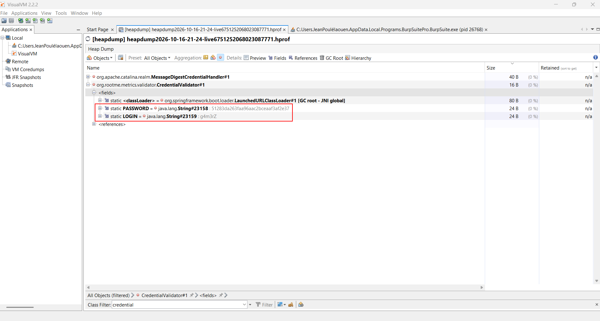

# Write-up — Root-Me "Web Serveur" ch46 (Spring Boot Actuator — Fuite de credentials via Heap Dump)

**Cible :** `challenge01.root-me.org/web-serveur/ch46`
**Stack identifiée :** Spring Boot (Tomcat embarqué, Java 8u144), application `metrics-0.0.1-SNAPSHOT.jar`
**Catégorie :** App - Système / Web Serveur
**Vulnérabilité exploitée :** Exposition non authentifiée des endpoints Spring Boot Actuator (`/env`, `/dump`, `/heapdump`, `/trace`) → fuite de credentials en mémoire

---

## 1. Résumé

L'application expose plusieurs endpoints **Spring Boot Actuator** sans aucune authentification. En récupérant un **heap dump** complet de la JVM via `/heapdump`, il est possible de retrouver en clair, dans les champs statiques de la classe applicative `CredentialValidator`, les identifiants de connexion codés en dur :

```
LOGIN    = g4m3rZ
PASSWORD = 51283da263faa96aac2bceaaf3af2e37
```

---

## 2. Reconnaissance initiale — `/env`

Une première requête sur l'endpoint Actuator `/env` confirme que l'application est un Spring Boot packagé en `.jar`, nommé `metrics-0.0.1-SNAPSHOT.jar`, tournant sur un Tomcat embarqué avec Java 8u144 :

```
GET /web-serveur/ch46/env HTTP/1.1
```

Extrait pertinent de la réponse JSON :

```json
"java.class.path": "/challenge/web-serveur/ch46/metrics-0.0.1-SNAPSHOT.jar",
"server.contextPath": "/web-serveur/ch46"
```

L'absence de protection sur `/env` indique une version pré-Boot 1.5 (ou une configuration `management.security.enabled=false`), où les endpoints Actuator sensibles sont exposés par défaut sans authentification.

---

## 3. Énumération des endpoints Actuator — `/dump`

L'endpoint `/dump` renvoie un **thread dump JVM** complet (liste des threads, états, piles d'appels). Il confirme, via la stack trace du thread ayant traité la requête, la présence active de plusieurs filtres Spring Boot, notamment :

```
org.springframework.boot.actuate.trace.WebRequestTraceFilter
org.springframework.boot.actuate.endpoint.DumpEndpoint
```

La présence de `WebRequestTraceFilter` confirmait que l'historique des requêtes HTTP (`/trace`) était également capturé en mémoire — mais celui-ci ne loggue pas les corps de requête (POST bodies), donc inutile pour récupérer des identifiants de connexion directement.

---

## 4. Récupération du heap dump — `/heapdump`

L'endpoint le plus critique, `/heapdump`, a été testé :

```
GET /web-serveur/ch46/heapdump HTTP/1.1
```

Il renvoie un fichier binaire **HPROF** (format standard des heap dumps JVM), compressé en `.gz`, faisant une fois décompressé environ **33 Mo**.

Ce fichier contient **l'intégralité de l'état mémoire vivant de l'application** au moment de la capture : toutes les instances d'objets, tous les tableaux, toutes les chaînes de caractères internées, y compris les constantes statiques des classes métier.

---

## 5. Première approche (limitée) : extraction de chaînes brutes

Une première analyse rapide avec `strings` (UTF-8 et UTF-16BE, puisque les `char[]` Java sont stockés en 16 bits) a permis de :

- Confirmer la présence des classes métier spécifiques au challenge :
  ```
  org.rootme.metrics.MetricsApplication
  org.rootme.metrics.controller.MetricsController
  org.rootme.metrics.model.LoginModel
  org.rootme.metrics.validator.CredentialValidator
  ```
- Retrouver l'historique de requêtes HTTP capturé par `WebRequestTraceFilter` (confirmant visuellement les tentatives de login effectuées sur le site), mais **sans accès aux corps de requête** (donc sans les valeurs saisies dans le formulaire).

Cette méthode ne permettait toutefois pas de relier une valeur de chaîne précise à un champ Java précis : `strings` extrait du texte brut sans comprendre la structure objet du heap, le classement spatial des chaînes dans le fichier ne correspondant pas nécessairement à leur proximité logique (liens entre objets, classes, champs).

---

## 6. Développement d'un parser HPROF minimal (Python)

Pour aller plus loin, un parser binaire HPROF a été écrit en Python afin de :

1. Indexer toutes les chaînes UTF-8 internées (`HPROF_UTF8`, tag `0x01`)
2. Associer les IDs de classe à leur nom (`HPROF_LOAD_CLASS`, tag `0x02`)
3. Parcourir les segments de heap dump (`HPROF_HEAP_DUMP`, tag `0x1c`) et traiter :
   - `GC_CLASS_DUMP` (`0x20`) : schéma des classes, **y compris les champs statiques et leurs valeurs**
   - `GC_INSTANCE_DUMP` (`0x21`) : instances d'objets et leurs champs
   - `GC_OBJ_ARRAY_DUMP` / `GC_PRIM_ARRAY_DUMP` (`0x22` / `0x23`) : tableaux, notamment les `char[]` qui portent le contenu réel des `String` Java

### Bugs rencontrés et corrigés

Deux erreurs ont bloqué le parsing initial :

- **Record root inconnu** : le tag `0xFF` (`ROOT_UNKNOWN`) n'était pas géré, ce qui désalignait la lecture binaire dès la première occurrence.
- **Table de tailles de types primitifs erronée** — la plus critique :

  ```python
  # Faux (bug initial)
  {2: idsz, 4:1, 5:1, 6:2, 7:2, 8:1, 9:2, 10:4, 11:8}

  # Correct (types JVM : boolean=1, char=2, float=4, double=8, byte=1, short=2, int=4, long=8)
  {2: idsz, 4:1, 5:2, 6:4, 7:8, 8:1, 9:2, 10:4, 11:8}
  ```

  `char` (type `5`) faisait 2 octets et non 1, `float` (`6`) 4 octets et non 2, `double` (`7`) 8 octets et non 2. Cette erreur décalait progressivement la lecture de chaque `CLASS_DUMP`, provoquant un plantage (`KeyError`) sur un type de champ invalide quelques classes plus loin. Une fois corrigée, le fichier complet (113 142 chaînes, 7 629 classes, 219 632 instances) a été parsé sans erreur.

### Résultat du parsing ciblé

En listant spécifiquement les champs **statiques** de la classe `org/rootme/metrics/validator/CredentialValidator`, le script a extrait :

```
static PASSWORD = objref(...) -> '51283da263faa96aac2bceaaf3af2e37'
static LOGIN    = objref(...) -> 'g4m3rZ'
```

Ces deux constantes sont codées en dur dans le bean Spring, et donc **présentes en clair dans le tas mémoire** tant que l'application tourne — exactement ce qu'un `/heapdump` non protégé permet d'exfiltrer.

---

## 7. Vérification indépendante avec VisualVM

Pour confirmer le résultat sans dépendre du script maison, le même heap dump a été ouvert dans **VisualVM** :

1. `File > Load...` → sélection du fichier `.hprof` décompressé
2. Onglet **Objects**, filtre de classe (`Class Filter`) sur `credential`
3. Sélection de `org.rootme.metrics.validator.CredentialValidator#1`
4. Dépliage du nœud `<fields>` — VisualVM affiche directement les champs `static` avec leurs valeurs résolues

Capture d'écran du résultat :



On y retrouve exactement les mêmes valeurs que via le parseur Python :

```
static PASSWORD = java.lang.String#23158 : 51283da263faa96aac2bceaaf3af2e37
static LOGIN    = java.lang.String#23159 : g4m3rZ
```

Cette double vérification (parsing manuel bas niveau + outil de référence) élimine tout risque d'erreur de lecture ou d'artefact du script maison.

---

## 8. Exploitation — tentative de connexion

Requête HTTP construite pour soumettre les identifiants trouvés au formulaire `/login` :

```http
POST /web-serveur/ch46/login HTTP/1.1
Host: challenge01.root-me.org
Content-Type: application/x-www-form-urlencoded
Content-Length: 54

login=g4m3rZ&password=51283da263faa96aac2bceaaf3af2e37
```

**Point d'attention relevé pendant l'exploitation :** une première tentative a échoué à cause d'une erreur de recopie du login — `g4r3mZ` envoyé au lieu de `g4m3rZ` (permutation des lettres `m` et `r`). Après relecture attentive de la capture VisualVM et correction de la valeur, la requête corrigée a été renvoyée avec le bon login.

---

## 9. Vulnérabilités identifiées

| Endpoint | Exposition | Impact |
|---|---|---|
| `/env` | Non authentifié | Fuite de variables d'environnement, propriétés système, chemins internes |
| `/dump` | Non authentifié | Fuite de threads actifs, piles d'appels, structure interne de l'application |
| `/heapdump` | Non authentifié | **Fuite complète de l'état mémoire** : secrets en dur, objets métier, sessions potentielles |
| `/trace` | Non authentifié (actif via `WebRequestTraceFilter`) | Historique des requêtes/réponses HTTP (headers, cookies) |

La vulnérabilité racine est une **mauvaise configuration de Spring Boot Actuator** (CWE-200 : Exposure of Sensitive Information), aggravée par une **mauvaise pratique de développement** : stockage de secrets en dur dans le code source (`CWE-798 : Use of Hard-coded Credentials`), qui les rend visibles dès que la mémoire du processus est accessible d'une façon ou d'une autre.

---

## 10. Recommandations de remédiation

1. **Sécuriser ou désactiver les endpoints Actuator sensibles** en production :
   ```properties
   management.security.enabled=true
   endpoints.heapdump.enabled=false
   endpoints.dump.enabled=false
   endpoints.trace.enabled=false
   endpoints.env.sensitive=true
   ```
   (Sur Spring Boot 2.x+, utiliser `management.endpoints.web.exposure.include` pour une liste blanche stricte.)
2. **Ne jamais coder des identifiants en dur** dans le code source ou en mémoire applicative : utiliser un coffre-fort de secrets externe (Vault, variables d'environnement injectées au runtime, AWS Secrets Manager, etc.).
3. **Hacher et saler** les mots de passe stockés avec un algorithme adapté (bcrypt, argon2) plutôt qu'un MD5 simple, qui est cryptographiquement cassé pour un usage de stockage de mots de passe.
4. **Restreindre l'accès réseau** aux endpoints de management (port de management séparé, filtrage IP, authentification dédiée) même lorsqu'ils doivent rester actifs pour le monitoring.

---

## 11. Conclusion

Ce challenge illustre un scénario d'exposition très réaliste des applications Spring Boot mal configurées : l'enchaînement `/env` → `/dump` → `/heapdump` permet de passer d'une simple reconnaissance à une **fuite totale des secrets applicatifs**, sans qu'aucune authentification ni exploit de mémoire sophistiqué ne soit nécessaire — un simple parsing du format HPROF (fait à la main ou via un outil comme VisualVM) suffit.
